# lab9_php_modular — Praktikum 9: PHP Modular

**Mata Kuliah:** Pemrograman Web (OBE)
**Modul:** Praktikum 9 — PHP Modular (Modularisasi Program, Function, Template, dan Routing)
**Nama:** Rafif Mizanurohman
**NIM:** 312510377
**Kelas:** I252A

---

## 1. Tujuan Project

Praktikum ini melanjutkan aplikasi CRUD data barang dari Praktikum 8 dengan
memodularkan seluruh program sesuai struktur acuan modul (bagian F):

1. Menjelaskan pengertian, tujuan, dan manfaat modularisasi program.
2. Membedakan penggunaan `include`, `require`, `include_once`, dan `require_once`.
3. Membuat template halaman web yang digunakan bersama oleh beberapa halaman.
4. Membuat dan menggunakan function PHP dengan parameter dan nilai kembalian.
5. Menyusun struktur direktori aplikasi PHP secara modular.
6. Menerapkan routing berdasarkan parameter URL dengan validasi halaman (whitelist).
7. Mengintegrasikan modularisasi dan routing ke aplikasi database dari praktikum sebelumnya.

**Prinsip yang diterapkan:** satu file memiliki tanggung jawab yang jelas —
header/footer hanya ada di `views/`, koneksi database hanya ada di `config/`,
function umum hanya ada di `helpers/`, dan fitur CRUD hanya ada di `modules/`.

---

## 2. Kebutuhan Perangkat

| Komponen | Keterangan |
|---|---|
| Laptop/PC | Windows, browser Chrome/Edge |
| Editor | Visual Studio Code |
| Web server | Apache (XAMPP) |
| PHP | PHP 8.2.12 (XAMPP), ekstensi `mysqli` |
| Database | MySQL Server (XAMPP), database `latihan1` (dipakai sejak Praktikum 8) |
| Pengelola database | phpMyAdmin (`http://localhost/phpmyadmin/`) |
| Pengujian | Playwright/Chromium headless — **48 pemeriksaan otomatis, semua PASS** |

---

## 3. Cara Menjalankan Aplikasi

1. Buka **XAMPP Control Panel**, klik **Start** pada layanan **Apache** dan **MySQL**.
2. Salin folder `lab9_php_modular` ke docroot web server: `C:\xampp\htdocs\`.
3. Pastikan database `latihan1` dengan tabel `data_barang` sudah ada
   (dibuat pada Praktikum 8; query tersedia di bagian 7, Langkah 1).
4. Buka browser:
   - `http://localhost/lab9_php_modular/` atau
   - `http://localhost/lab9_php_modular/index.php` → Dashboard.
5. Jangan membuka file PHP dengan klik ganda — selalu akses lewat web server.

**Pengujian otomatis** (Apache + MySQL harus menyala):

```
python uji_otomatis.py
```

Skrip akan menjalankan 48 pemeriksaan, menyimpan screenshot ke folder
`screenshots/`, dan menulis ulang `hasil_pengujian.txt`.

---

## 4. Struktur Direktori

```
lab9_php_modular/
├── index.php                # router — titik masuk & whitelist rute
├── .htaccess                # URL rewrite ringkas (opsional, bagian H modul)
├── pesan.php                # file uji untuk include/require (bagian C)
├── uji-include.php          # praktik include
├── uji-require.php          # praktik require (perbandingan)
├── uji_otomatis.py          # skrip pengujian Playwright 48 check
├── hasil_pengujian.txt      # rekapan hasil pengujian otomatis
├── config/
│   └── database.php         # SATU-SATUNYA konfigurasi koneksi (mysqli)
├── views/                   # komponen tampilan bersama + halaman konten
│   ├── header.php           # awal HTML, judul, navigasi, pesan flash
│   ├── footer.php           # penutup halaman
│   ├── dashboard.php        # halaman utama (default rute)
│   ├── home.php             # Latihan 1 — template multi-halaman
│   ├── profil.php           # Latihan 1 + demo ringkasTeks()
│   ├── kontak.php           # Latihan 1 + demo validasiEmail()
│   └── 404.php              # halaman rute tidak dikenal
├── helpers/
│   └── functions.php        # pustaka function umum (Latihan 2)
├── modules/
│   └── barang/              # fitur CRUD dikelompokkan per domain
│       ├── list.php         # READ
│       ├── add.php          # CREATE
│       ├── edit.php         # UPDATE
│       └── delete.php       # DELETE (POST + CSRF saja)
├── assets/
│   ├── css/style.css        # seluruh gaya halaman
│   └── js/app.js            # pesan flash otomatis menghilang
├── gambar/                  # gambar barang (termasuk hasil unggahan)
├── screenshots/             # 15 screenshot hasil pengujian
└── README.md
```

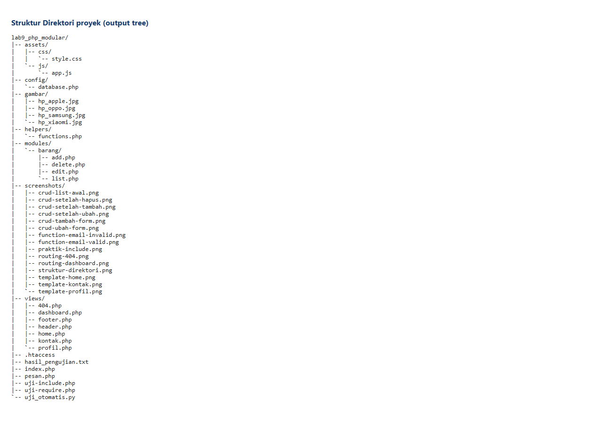

**Tanggung jawab (bagian F modul):**

- `index.php` — titik masuk aplikasi dan pengatur pemanggilan halaman (router).
- `config/` — konfigurasi aplikasi, termasuk koneksi database.
- `views/` — komponen tampilan yang digunakan bersama.
- `helpers/` — function umum yang dapat digunakan banyak modul.
- `modules/` — kumpulan fitur aplikasi dikelompokkan berdasarkan domain.
- `assets/` — file statis (CSS, JavaScript, gambar).

---

## 5. Daftar Rute (Whitelist Router)

| URL | File yang dimuat | Keterangan |
|---|---|---|
| `index.php` / `index.php?page=dashboard` | `views/dashboard.php` | Dashboard (default) |
| `index.php?page=home` | `views/home.php` | Latihan 1 — Home |
| `index.php?page=profil` | `views/profil.php` | Latihan 1 — Profil |
| `index.php?page=kontak` | `views/kontak.php` | Latihan 1 — Kontak |
| `index.php?page=barang/list` | `modules/barang/list.php` | READ — daftar barang |
| `index.php?page=barang/add` | `modules/barang/add.php` | CREATE — tambah barang |
| `index.php?page=barang/edit&id=1` | `modules/barang/edit.php` | UPDATE — ubah barang |
| `index.php?page=barang/delete` | `modules/barang/delete.php` | DELETE — hanya POST + CSRF |
| rute lain (mis. `page=admin/rahasia`) | `views/404.php` | HTTP 404 |

**Keamanan router:** input `page` **tidak pernah** disusun menjadi path file
(`require $_GET['page'].'php'` dilarang karena berisiko *path traversal*).
Router hanya memuat file yang terdaftar pada array `$routes` (whitelist).
Parameter dengan tipe salah (array) dan path traversal otomatis ditolak 404.

Halaman 404:

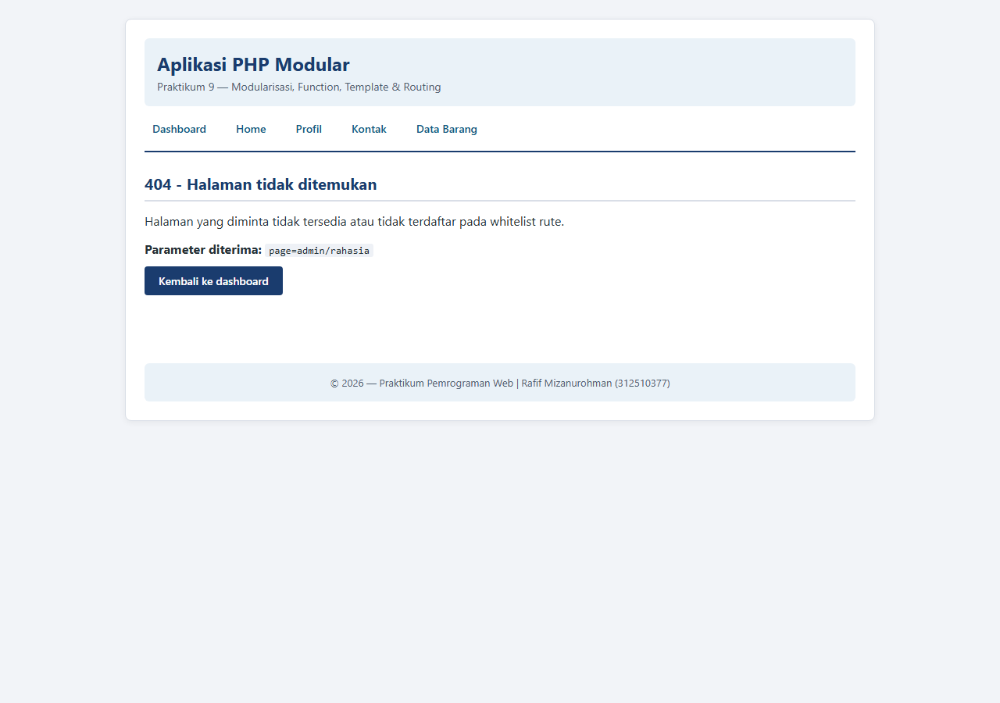

---

## 6. Langkah Praktikum dan Hasil

> Seluruh screenshot diambil dari browser headless (Playwright/Chromium) dengan
> interaksi nyata: mengisi form, mengunggah file, dan menekan tombol.
> Rincian: **48 pemeriksaan — 48 PASS, 0 gagal** (file `hasil_pengujian.txt`).

### Langkah 1 — Praktik `include` dan `require` (bagian C)

File `pesan.php` dicetak oleh `uji-include.php`:

```php
<!-- uji-include.php -->
<?php
echo "Sebelum pemanggilan<br>";
include __DIR__ . '/pesan.php';
echo "Sesudah pemanggilan<br>";
?>
```

**Hasil percobaan** (file `pesan.php` di-rename sementara lalu dikembalikan):

| Konstruksi | File tidak ditemukan | Baris sesudah pemanggilan |
|---|---|---|
| `include` | Warning, eksekusi berlanjut | **Tetap dijalankan** |
| `require` | Error fatal, eksekusi berhenti | **Tidak dijalankan** |
| `include_once` / `require_once` | seperti di atas + mencegah pemuatan berulang | — |

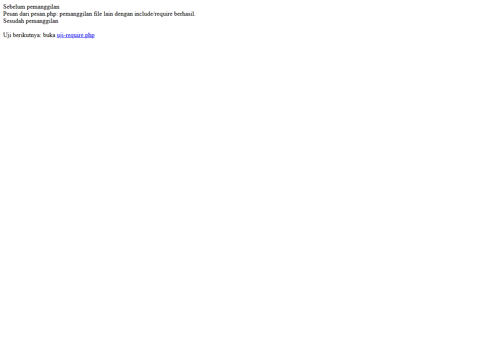

### Langkah 2 — Template Layout bersama (bagian D, Latihan 1)

`views/header.php` berisi awal dokumen HTML + navigasi; `views/footer.php`
berisi penutup halaman. Ketiga halaman Latihan 1 (Home, Profil, Kontak) —
dan seluruh halaman lain — memakai template yang sama **tanpa menyalin
kode header/footer**:

```php
<?php require_once __DIR__ . '/header.php'; ?>
<!-- konten halaman -->
<?php require_once __DIR__ . '/footer.php'; ?>
```

Header/footer sebenarnya dipanggil oleh router `index.php` sekali untuk semua
rute, sehingga tidak mungkin terjadi "konten tampil ganda". Menu aktif
(*active navigation*) ditandai function `nav_aktif($rute, $page)`.

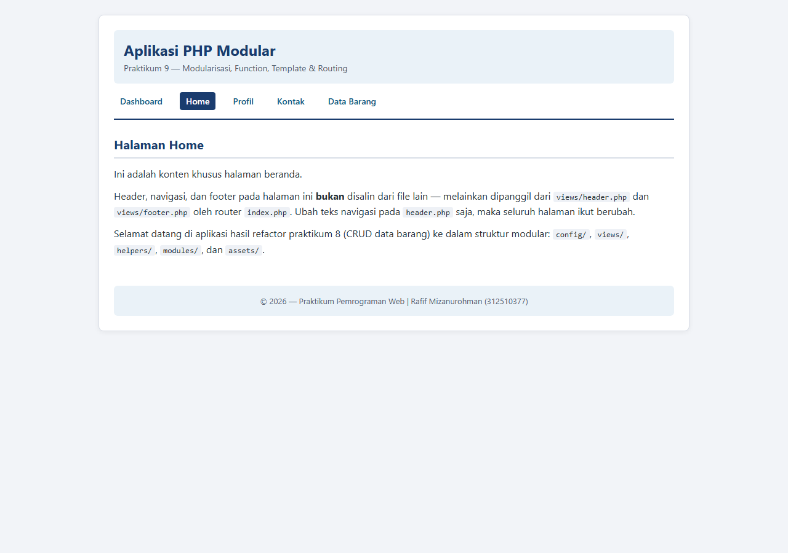
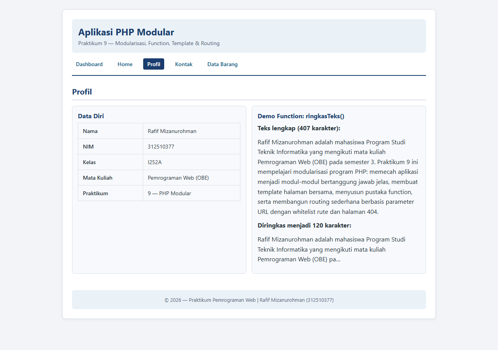
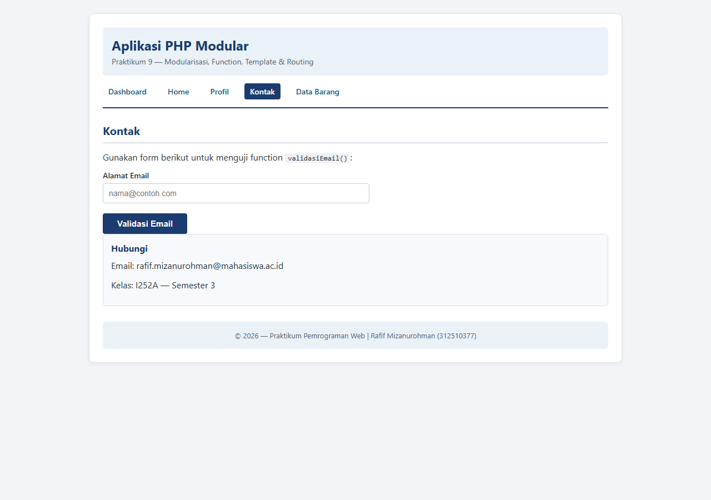

### Langkah 3 — Library function (bagian E, Latihan 2)

Seluruh function berada di `helpers/functions.php` dan dipanggil dari
banyak halaman berbeda:

| Function | Parameter → Return | Dipakai di |
|---|---|---|
| `formatRupiah(float)` | `150000` → `"Rp 150.000"` | dashboard, list, edit |
| `hitungDiskon(float, float = 10)` | diskon nilai rupiah | dashboard, edit |
| `validasiEmail(string)` | → `true/false` | halaman kontak |
| `ringkasTeks(string, int = 80)` | potong teks + `…` | halaman profil |
| `e(string)` | escaping HTML anti-XSS | semua tampilan |
| `set_flash()` / `get_flash()` | pesan sukses/gagal antarhalaman | semua operasi CRUD |
| `csrf_token()` / `csrf_valid()` | token anti-CSRF | semua form POST |
| `nav_aktif(string, string)` | atribut `class="aktif"` | header navigasi |

Contoh pemakaian nilai return:

```php
echo formatRupiah(hitungDiskon(200000, 15));  // Rp 30.000
echo e($row['nama']);                         // escape sebelum tampil
if (validasiEmail($email)) { ... }            // return boolean
echo ringkasTeks($bio, 120);                  // bio dipotong 120 karakter
```

Dashboard (demo `hitungDiskon` + `formatRupiah` + status koneksi):

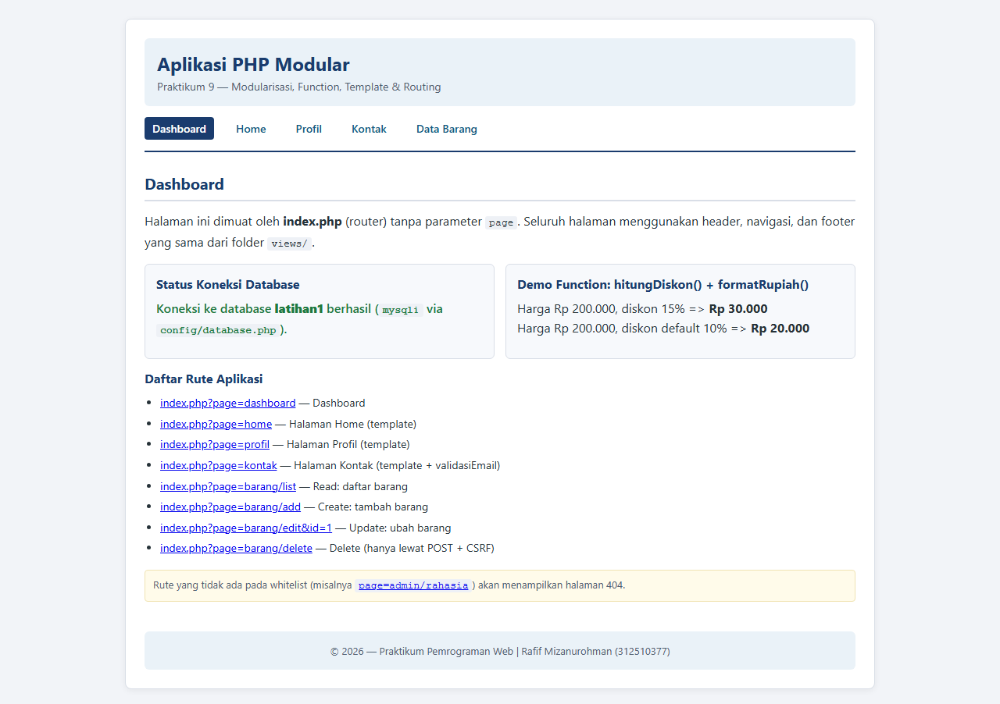

Validasi email pada halaman Kontak:

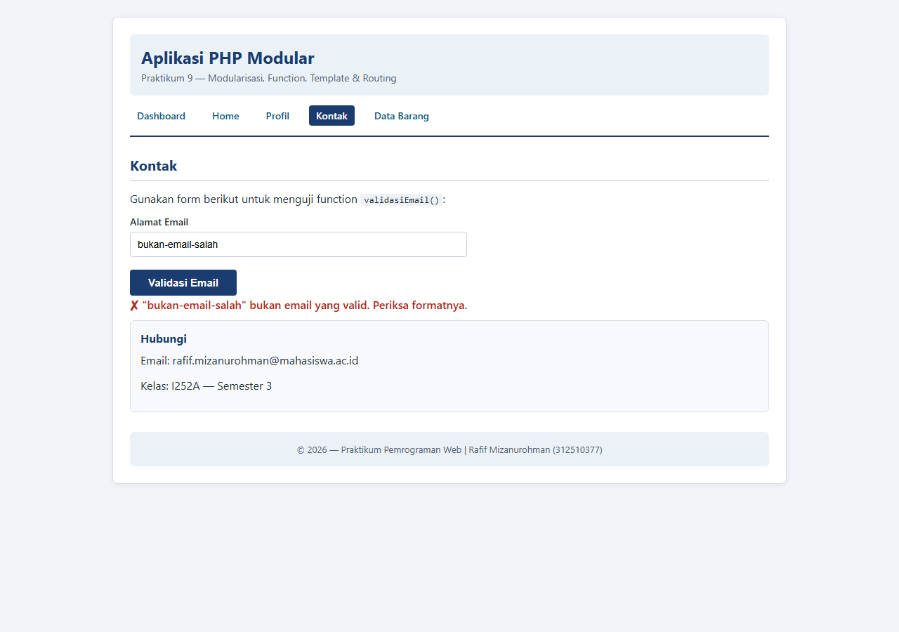
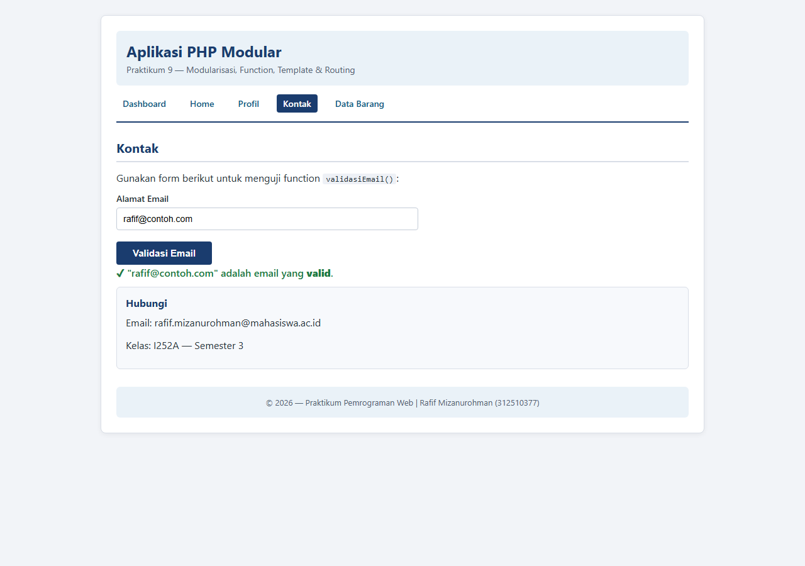

### Langkah 4 — Struktur direktori modular (bagian F)

Folder `config/`, `views/`, `helpers/`, `modules/`, dan `assets/` dibuat
sesuai acuan modul. Koneksi database dipindahkan dari `koneksi.php` ke
`config/database.php` dan dimuat **hanya sekali** dengan `require_once`
dari router (lihat gambar struktur di bagian 4).

### Langkah 5 — Router aman (bagian G, Latihan 3)

Implementasi whitelist pada `index.php` (lihat kode lengkap di `index.php`):

```php
$routes = [
    'dashboard'     => __DIR__ . '/views/dashboard.php',
    'home'          => __DIR__ . '/views/home.php',
    'profil'        => __DIR__ . '/views/profil.php',
    'kontak'        => __DIR__ . '/views/kontak.php',
    'barang/list'   => __DIR__ . '/modules/barang/list.php',
    'barang/add'    => __DIR__ . '/modules/barang/add.php',
    'barang/edit'   => __DIR__ . '/modules/barang/edit.php',
    'barang/delete' => __DIR__ . '/modules/barang/delete.php',
];

$page = $_GET['page'] ?? 'dashboard';
if (!array_key_exists($page, $routes)) {
    http_response_code(404);
    $contentFile = __DIR__ . '/views/404.php';
} else {
    $contentFile = $routes[$page];
}
```

Hasil pengujian routing (semua PASS):

| Pengujian | Hasil |
|---|---|
| `index.php` (tanpa page) | 200 — Dashboard |
| `page=home/profil/kontak` | 200 — konten sesuai + menu aktif |
| `page=admin/rahasia` | **404** — halaman 404 tampil |
| `page=` (kosong) | 200 — aman, dianggap dashboard |
| `page[]=x` (tipe salah) | **404** — aman |
| `page=../../etc/passwd` | **404** — path traversal ditolak |

### Langkah 6 — Refactoring CRUD Praktikum 8 (bagian I, Latihan 4)

Aplikasi CRUD data barang disalin dari Praktikum 8 lalu di-refactor:

| Bagian CRUD Praktikum 8 | Pindah ke (bagian F) |
|---|---|
| `koneksi.php` | `config/database.php` (dimuat `require_once` sekali) |
| HTML header/nav/footer tiap halaman | `views/header.php` + `views/footer.php` |
| Fungsi bantu (`is_select`, format harga, escaping) | `helpers/functions.php` |
| `index.php`, `tambah.php`, `ubah.php`, `hapus.php` | `modules/barang/list.php`, `add.php`, `edit.php`, `delete.php` |
| `style.css` | `assets/css/style.css` |

Semua tautan kini memakai pola `index.php?page=…` dan seluruh halaman
menggunakan template yang sama.

**Read** — daftar barang (harga tampil `formatRupiah`, tautan aksi via router):

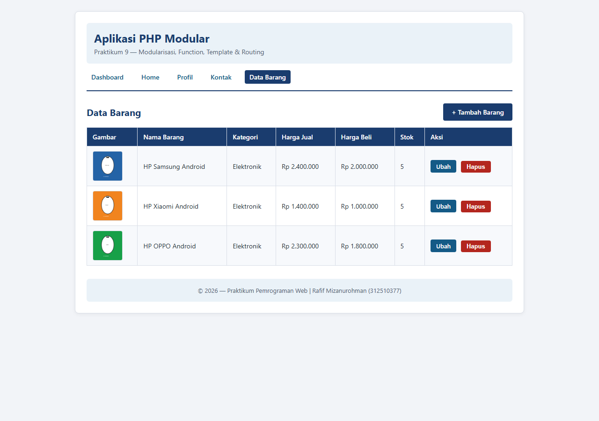

**Create** — form + unggah gambar, lalu data ke-4 tampil:

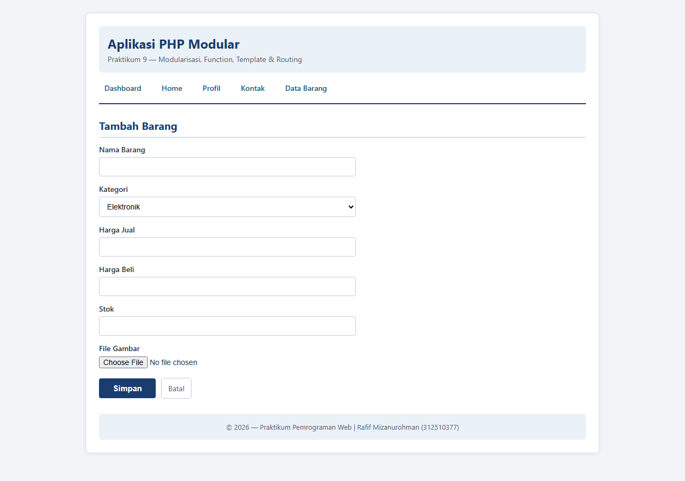
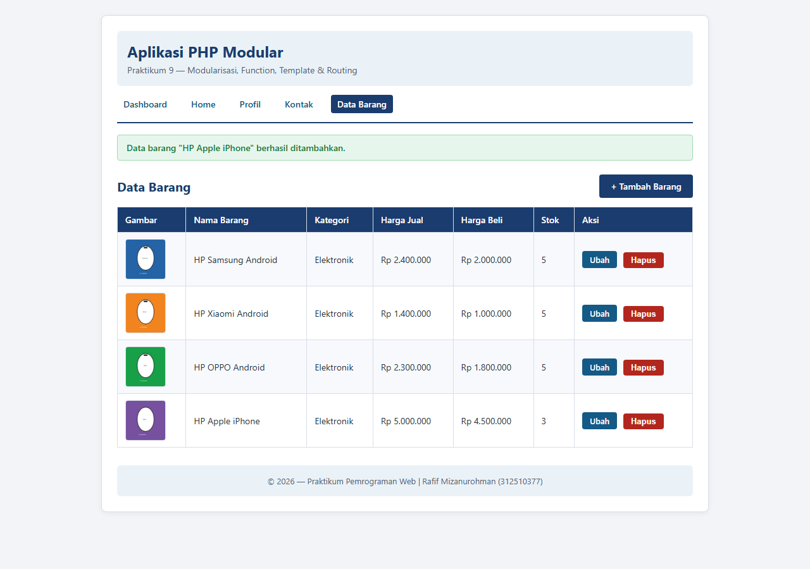

**Update** — form terisi data lama (pratinjau diskon memakai `hitungDiskon`):

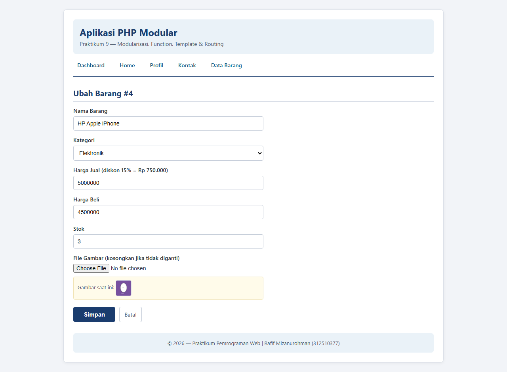
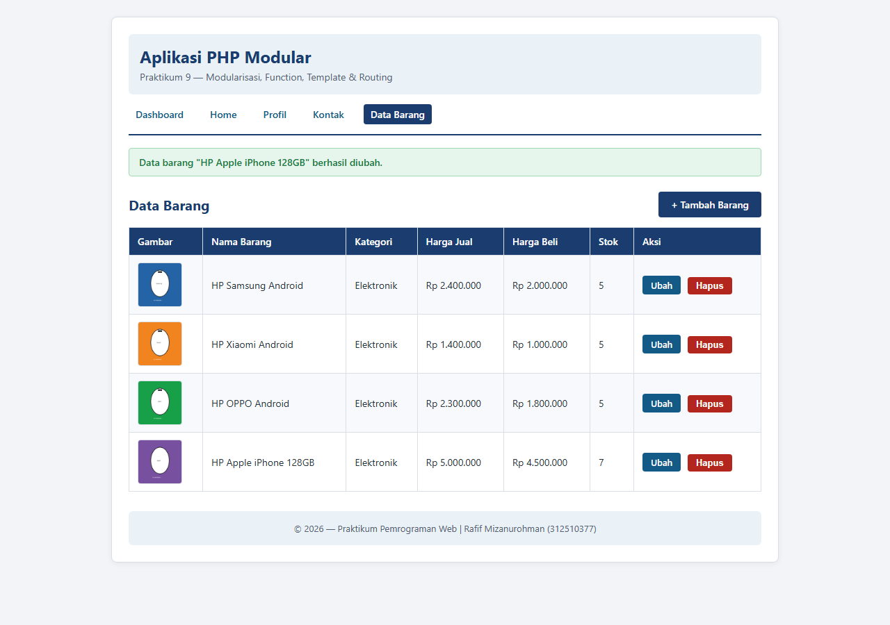

**Delete** — tombol Hapus mengirim POST + token CSRF + konfirmasi:

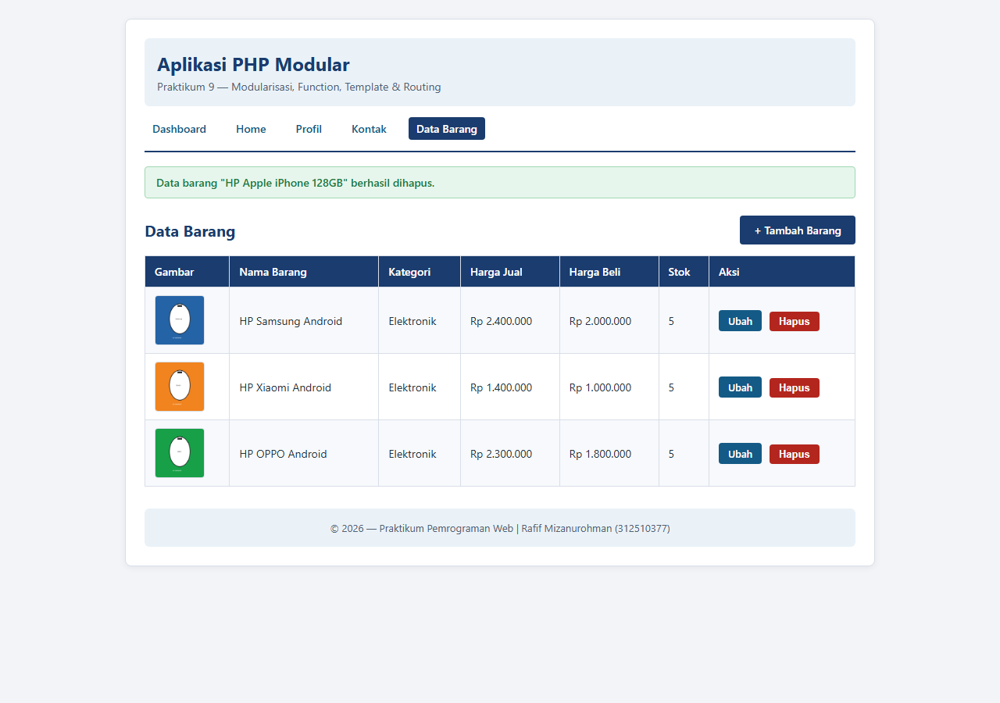

### Langkah 7 — URL ringkas dengan `.htaccess` (bagian H, opsional)

```apache
RewriteEngine On
RewriteCond %{REQUEST_FILENAME} !-f
RewriteCond %{REQUEST_FILENAME} !-d
RewriteRule ^(.+)$ index.php?page=$1 [QSA,L]
```

Dengan aturan ini `/lab9_php_modular/barang/list` diteruskan ke
`index.php?page=barang/list`. Fitur ini memerlukan `mod_rewrite` aktif dan
`AllowOverride` sesuai pada konfigurasi Apache XAMPP.

---

## 7. Hasil Pengujian Otomatis

Pengujian dijalankan dengan Playwright/Chromium headless yang berinteraksi
sungguhan: membuka halaman, mengisi form, mengunggah file gambar, dan
menekan tombol. Hasil akhir: **48 pemeriksaan — 48 PASS, 0 gagal**.

Cakupan pemeriksaan:

- **Template** — header/navigasi/footer sama pada semua halaman, hanya
  satu `<footer>`/`<h1>` per halaman (tidak ada salinan kode), menu aktif benar.
- **Function** — `formatRupiah`, `hitungDiskon`, `ringkasTeks`, `validasiEmail`
  terbukti menghasilkan nilai yang benar di halaman berbeda.
- **Routing** — 8 rute valid tampil; rute tak dikenal, tipe data salah, dan
  path traversal menghasilkan status 404; `page` kosong aman (dashboard).
- **CRUD** — Read (3 data awal + format Rupiah), Create (unggah `hp_apple.jpg`,
  data ke-4 muncul), Update (nama & stok berubah), Delete (kembali 3 data).
- **Keamanan** — akses GET `page=barang/delete` **tidak** menghapus data;
  POST tanpa token CSRF ditolak; tidak ada satu pun pesan error PHP/JS.

Rincian lengkap: [`hasil_pengujian.txt`](hasil_pengujian.txt).

---

## 8. Kendala yang Ditemukan dan Cara Mengatasinya

| No | Kendala | Penyebab | Cara mengatasinya |
|---|---|---|---|
| 1 | `header('Location: …')` tidak berpindah halaman setelah proses CRUD | Router sudah me-render `views/header.php` (HTML terkirim) sebelum modul dieksekusi | Router membungkus render dengan `ob_start()`; function `redirect()` membuang buffer (`ob_end_clean()`) sebelum mengirim header lalu `exit`. |
| 2 | Muncul error *Function already declared* saat pengembangan | `helpers/functions.php` pernah dimuat lebih dari satu kali | Gunakan `require_once` (file inti) — sama seperti anjuran modul untuk konfigurasi database. |
| 3 | Halaman 404 tampil tetapi menu navigasi ikut hilang/rancu | Variabel `$page` untuk penanda menu aktif tidak tersedia pada rute 404 | Router menyetel `$page = '404'`; `header.php` memberi nilai default bila `$page` belum ada. |
| 4 | `page[]=x` (array) menyebabkan peringatan tipe data | `array_key_exists()` menerima nilai non-string | Router memeriksa `is_string($page)` terlebih dahulu — bukan string → 404. |
| 5 | Setelah unggah gambar, gambar tidak tampil (Praktikum 8) | Path disimpan ganda `gambar/gambar/x.jpg` | Path disimpan hanya nama file polo; folder tujuan dihitung dengan `dirname(__DIR__, 2) . '/gambar/'`. |
| 6 | URL rewrite `.htaccess` tidak aktif saat pertama dicoba | `mod_rewrite`/`AllowOverride` belum tentu aktif | Catatan: aktifkan `LoadModule rewrite_module` dan `AllowOverride All` pada `httpd.conf`, lalu restart Apache; aplikasi tetap berfungsi penuh tanpa rewrite (semua rute pakai `index.php?page=…`). |
| 7 | Pengujian headless gagal dijalankan | Browser build Playwright belum terunduh | `python -m playwright install chromium-headless-shell`. |

---

## 9. Pertanyaan Pemahaman (bagian L)

1. **Pengertian modularisasi & manfaatnya** — membagi aplikasi menjadi modul
   bertanggung jawab jelas agar kode mudah dipahami, dipakai ulang, diuji, dan
   dikembangkan. Manfaat: (a) header/footer/koneksi tidak ditulis berulang,
   (b) perubahan tampilan cukup mengubah satu file, (c) pemeliharaan mudah
   ditelusuri dan pengembangan tim tidak rawan konflik.
2. **`include` vs `require`** — `include` menghasilkan warning bila file tidak
   ditemukan dan eksekusi umumnya berlanjut; `require` menghasilkan error fatal
   sehingga eksekusi dihentikan.
3. **`require_once` untuk konfigurasi database** — konfigurasi wajib tersedia
   (bila hilang program tidak boleh jalan) dan hanya boleh dideklarasikan satu
   kali agar tidak terjadi duplikasi variabel/fungsi.
4. **Parameter, argumen, nilai return** — *parameter* dideklarasikan pada
   function; *argumen* adalah nilai yang dikirim saat pemanggilan; *return*
   mengembalikan nilai ke pemanggil (bisa disimpan/dihitung), sedangkan `echo`
   langsung menampilkan keluaran.
5. **Header/footer dipisah dari konten** — agar perubahan tampilan cukup pada
   satu file dan konten tiap halaman tetap fokus pada tanggung jawabnya
   (prinsip *single responsibility*).
6. **Fungsi `index.php`** — menjadi titik masuk dan router: membaca parameter
   `page`, memvalidasi rute, lalu memuat file konten yang benar serta
   template bersama.
7. **Whitelist rute** — membatasi file yang boleh dimuat sehingga input URL
   tidak pernah dipercaya langsung.
8. **Risiko `require $_GET['page'].'.php'`** — *path traversal* (mis.
   `../../etc/passwd`) dan pemanggilan file yang tidak dimaksudkan.
9. **`RewriteCond` & `RewriteRule`** — `RewriteCond` memberi syarat (file/direktori
   fisik tidak ada), `RewriteRule` meneruskan request yang memenuhi syarat ke
   `index.php?page=$1`.
10. **Bagian CRUD yang dipindahkan** — koneksi → `config/`; header/nav/footer →
    `views/`; validasi/format → `helpers/`; halaman tambah/ubah/hapus/daftar →
    `modules/`.

---

## 10. Kesimpulan

Seluruh latihan Praktikum 9 terpenuhi: aplikasi dipecah menjadi `config/`,
`views/`, `helpers/`, `modules/`, dan `assets/`; ketiga halaman Home/Profil/Kontak
serta seluruh halaman CRUD memakai template bersama tanpa menyalin kode;
pustaka function (termasuk empat function wajib Latihan 2) digunakan ulang di
banyak halaman; router `index.php` menerapkan whitelist dengan halaman 404 dan
menolak input yang salah tipe maupun path traversal; dan CRUD data barang dari
Praktikum 8 berjalan penuh melalui struktur modular dengan tautan
`index.php?page=…`. Pengujian otomatis browser headless membuktikan seluruh
alur berjalan **48/48 PASS** tanpa error PHP maupun JavaScript, termasuk
perlindungan CSRF dan pemblokiran penghapusan lewat URL GET.
